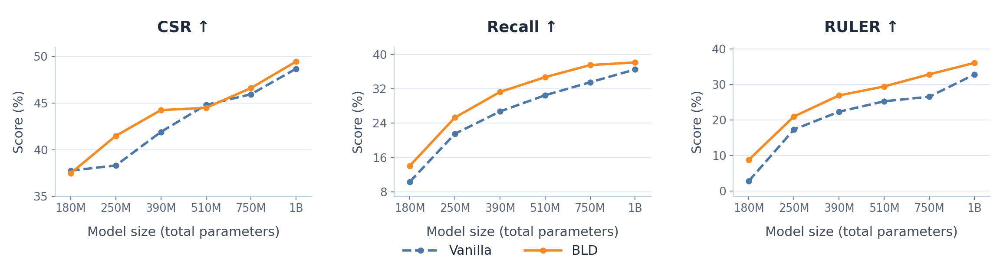
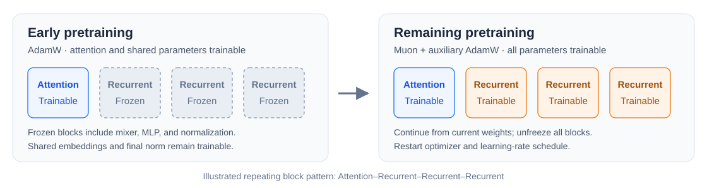

<div align="center">

# Competing Learning in Hybrid Architectures

**Xingyu Shen<sup>∗</sup> · Yingfa Chen<sup>∗</sup> · Ziqing Qiao · Chaojun Xiao · Xu Han · Zhiyuan Liu**

Tsinghua University · <sup>∗</sup> Equal contribution

[🚀 Quick Start](#quick-start) · [📊 Reproduce Results](docs/REPRODUCE.md) · [⚙️ Environment](docs/ENVIRONMENT.md) · [📚 Citation](#citation)

</div>

Hybrid language models combine recurrent mixers with softmax attention, but these
components can **compete to learn the same retrieval functions**. When recurrent
layers learn retrieval first, they weaken the learning signal available to attention.
**Better Layer Division (BLD) gives attention a head start by freezing recurrent
blocks early in pretraining, then unfreezing the full model.** The architecture stays
the same throughout training.



**KDA results across model scales.** CSR, Recall, and RULER scores compare Vanilla
and BLD across the six configurations. Values come from Table 1 of
the paper and are available in [results_table.csv](results_table.csv).

<details>
<summary>🔍 How BLD is trained</summary>



Stage 1 freezes each complete recurrent block, including its mixer, MLP, and
normalization. Attention blocks, embeddings, and the final normalization remain
trainable. Stage 2 loads the learned weights and starts a fresh optimizer and
schedule. The vanilla baseline updates every block in both stages, using the same
architecture, data, token budgets, and optimizer schedules.

</details>

## ⚙️ Installation

Use Linux x86_64 and an NVIDIA GPU supporting BF16. The validated environment uses
Python 3.11.14, PyTorch 2.8.0 with CUDA 12.8, and Triton 3.4.0.

```bash
conda env create -f environment.yml
conda activate bld
bash scripts/install_cuda.sh
python -m pip check
```

The Conda recipe installs the complete training, evaluation, and plotting environment
from [requirements-lock.txt](requirements-lock.txt). The CUDA installer verifies the
official FlashAttention and causal-conv1d wheels against their SHA-256 digests.
The code runs directly from this checkout.
[Environment, alternative CUDA builds, and validation →](docs/ENVIRONMENT.md)

<a id="quick-start"></a>

## 🚀 Quick Start

Check the real two-stage training launcher on **one allocated GPU**:

```bash
TMPDIR=/tmp bash scripts/smoke_test.sh \
  --output outputs/smoke --method bld --steps 1
```

This trains a small KDA hybrid for **one optimizer update per stage**, using a local
tokenizer and generated parquet data. It checks forward/backward passes, recurrent
block freezing and unfreezing, the AdamW-to-Muon handoff, and GPU model reload.
Checkpoints, a training log, and `report.json` are saved under `outputs/smoke`.
First-use kernel compilation can take several minutes.

Use `--method both --steps 2` to check both vanilla and BLD, or add `--model gdn`
or `--model gla` to check a transfer architecture. A fresh Conda environment has
passed this single-update BLD run and all nine CPU checks; see the
[validation results](docs/ENVIRONMENT.md#clean-environment-checks).

<a id="reproduce-results"></a>

## 📊 Reproduce Results

Prepare two disjoint DCLM parquet directories, each with a `text` column: global
shard 01 for Stage 1 and global shards 02–10 for Stage 2. Then launch the paper's
390M KDA configuration for both methods:

```bash
export DCLM_STAGE1=/path/to/dclm/global-shard-01
export DCLM_STAGE2=/path/to/dclm/global-shards-02-10
export TOKENIZER=Qwen/Qwen3-0.6B  # or a local tokenizer directory

bash scripts/run_main.sh 390m both
```

Use `bld` or `vanilla` to select one method. Append `stage1` or `stage2` to run an
individual stage. Outputs are saved under
`outputs/bld/<model>-<method>-seed0-stage<1|2>/`; use a new `OUTPUT_DIR` for repeat
runs. `NPROC` controls the GPU count while preserving the global batch.

<details>
<summary>📐 Model configurations and default GPU counts</summary>

| Model argument | Recurrent mixer | Total parameters | GPUs |
| --- | --- | ---: | ---: |
| `180m` | KDA | 180.7M | 1 |
| `250m` | KDA | 253.8M | 1 |
| `390m` | KDA | 390.9M | 2 |
| `510m` | KDA | 508.0M | 2 |
| `750m` | KDA | 754.7M | 2 |
| `1b` | KDA | 1,014.5M | 8 |
| `gdn-400m` | Gated DeltaNet | 400.4M | 2 |
| `gla-400m` | Gated Linear Attention | 400.6M | 2 |

All configurations use a repeating Attention–Recurrent–Recurrent–Recurrent pattern,
tied embeddings, NoPE, and 16,384-token contexts. Exact parameter counts and
aggregate paper scores are in [results_table.csv](results_table.csv).

</details>

For Slurm, run `bash scripts/submit_main.sh 390m both` from the active environment.
Set `PARTITION` for your cluster if needed. The launcher always excludes `g30` and
preserves additional node exclusions.

**[Full reproduction commands →](docs/REPRODUCE.md)** cover Spaced Retrieval,
layer attribution, freezing/unfreezing, gradient interventions, retrieval-head
identification and masking, CSR, Recall, RULER, WikiText-2, LongPPL, context
utilization, and scaling fits. Training corpora, benchmark data, tokenizer files,
and model weights are obtained separately.

## 🗂️ Code Layout

```text
scripts/                       # Main training, smoke tests, and experiment launchers
configs/                       # Paper architectures and two-stage schedules
modeling/                      # KDA, Gated DeltaNet, and GLA hybrid models
data/                          # DCLM packing and passkey data
optim/                         # AdamW, Muon, and learning-rate schedules
trainer/                       # Distributed training and stateful checkpoints
experiments/
├── retrieval/                 # Spaced Retrieval, attribution, and gradient analysis
├── heads/                     # Retrieval-head identification and masking
└── ...                        # Plotting and scaling fits
evaluation/                    # Benchmark runners and included Based tasks
tests/                         # CPU release checks
```

- [Reproduction guide](docs/REPRODUCE.md) — experiment commands and scoring protocols.
- [Environment guide](docs/ENVIRONMENT.md) — dependencies, hardware, and tested setup.
- [Third-party notices](THIRD_PARTY.md) — retained upstream code and licenses.

<a id="citation"></a>

## 📚 How to Cite?

If you use this code in your research, please cite:

```bibtex
@misc{shen2027competinglearning,
  title = {Competing Learning in Hybrid Architectures},
  author = {Xingyu Shen and Yingfa Chen and Ziqing Qiao and Chaojun Xiao and Xu Han and Zhiyuan Liu},
  year = {2027},
}
```
