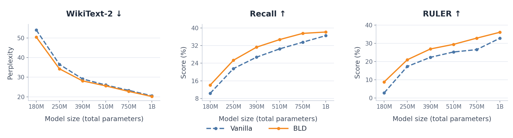

<div align="center">

# Competing Learning in Hybrid Architectures

**Xingyu Shen<sup>∗</sup> · Yingfa Chen<sup>∗</sup> · Ziqing Qiao · Chaojun Xiao · Xu Han · Zhiyuan Liu**

Tsinghua University · <sup>∗</sup> Equal contribution

<a href="https://arxiv.org/abs/2610.26830"></a>

[🚀 Quick Start](#quick-start) · [🔬 Analysis](#analysis-experiments) · [📊 Reproduce Results](docs/REPRODUCE.md) · [⚙️ Environment](docs/ENVIRONMENT.md) · [📚 Citation](#citation)

</div>

Hybrid language models combine recurrent mixers with softmax attention, but these
components can **compete to learn the same retrieval functions**. When recurrent
layers learn retrieval first, they weaken the learning signal available to attention.
**Better Layer Division (BLD) freezes RNN layers during early pretraining, giving
attention a first-mover advantage in Competing Learning.** This division of labor is
preserved and reinforced throughout the remainder of pretraining.



**KDA results across model scales.** WikiText-2 perplexity (↓), Recall (↑), and
RULER (↑) compare Vanilla and BLD across the six configurations. Values come from
Table 1 of the paper and are available in [results_table.csv](results_table.csv).

<details>
<summary>🔍 How BLD is trained</summary>


During early pretraining, BLD freezes each complete recurrent block, including its
mixer, MLP, and normalization. Attention blocks, embeddings, and the final
normalization remain trainable. All blocks are then unfrozen for the remainder of
pretraining, continuing from the current weights. AdamW is used during early
pretraining, followed by Muon with auxiliary AdamW after unfreezing; both methods
reset the optimizer and schedule at this point. The vanilla baseline updates every
block throughout pretraining, using the same architecture, data, token budgets,
and optimization schedules.

</details>

## ⚙️ Installation

Use Linux x86_64 and an NVIDIA GPU supporting BF16. The provided environment uses
Python 3.11.14, PyTorch 2.8.0 with CUDA 12.8, and Triton 3.4.0.

```bash
conda env create -f environment.yml
conda activate bld
bash scripts/install_cuda.sh
python -m pip check
```

The Conda recipe installs the complete training, evaluation, and plotting environment
from [requirements-lock.txt](requirements-lock.txt). The CUDA installer verifies the
official FlashAttention and causal-conv1d wheels against their SHA-256 digests.
The code runs directly from this checkout.
[Environment and CUDA builds →](docs/ENVIRONMENT.md)

<a id="quick-start"></a>

## 🚀 Quick Start

Check the pretraining launcher on **one allocated GPU**:

```bash
bash scripts/smoke_test.sh \
  --output outputs/smoke --method bld --steps 1
```

This trains a small KDA hybrid for **one optimizer update during early pretraining
and one after unfreezing**, using a local tokenizer and generated parquet data. It
checks forward/backward passes, recurrent block freezing and unfreezing, the
AdamW-to-Muon transition, and GPU model reload.
Outputs are saved under `outputs/smoke`.

Use `--method both --steps 2` to check both vanilla and BLD, or add `--model gdn`
or `--model gla` to check a transfer architecture.

<a id="section-3"></a>
<a id="analysis-experiments"></a>

## 🔬 Analysis Experiments

We use [Spaced Retrieval](experiments/retrieval/run.py) to study how recurrent and
attention layers acquire retrieval abilities, and how an early advantage shapes
their specialization. A small KDA–attention hybrid learns to recall five-digit keys
across short and long gaps.

[Counterfactual interventions](experiments/retrieval/core.py) track each layer's
retrieval ability through the signed change in answer logit margin. Freezing and
unfreezing recurrent blocks lets us examine how their progress affects attention,
while [gradient diagnostics](experiments/retrieval/gradients.py) follow changes in
the attention layers' learning signal. Varying the balance of short- and
long-distance examples reveals how the data distribution influences this competition.

Run the experiments on an allocated GPU; the synthetic data are generated locally:

```bash
# Train on Spaced Retrieval and track layer retrieval ability:
python -m experiments.retrieval.run --output outputs/retrieval/baseline
# Freeze recurrent blocks after 175 updates:
python -m experiments.retrieval.run --output outputs/retrieval/frozen --freeze-step 175
# Follow attention gradients through freezing and unfreezing:
python -m experiments.retrieval.gradients --output outputs/gradients/seed0
# Change the share of short-distance examples:
python -m experiments.retrieval.run --output outputs/retrieval/short10 --short-percent 10
```

Retrieval runs record layer scores and greedy accuracy. The
[plotting tools](experiments/plot.py) summarize layer trajectories, mixture endpoints,
and attention-gradient ratios. Use a new output directory when repeating a run.

**[Experiment settings and reproduction commands →](docs/REPRODUCE.md#analysis-experiments)**
include metric definitions, unfreezing experiments, complete sweeps, and plotting.

<a id="reproduce-results"></a>

## 📊 Reproduce Results

Prepare two disjoint DCLM parquet directories, each with a `text` column: global
shard 01 for early pretraining and global shards 02–10 for the remainder of
pretraining. Then launch the paper's 390M KDA configuration for both methods:

```bash
export DCLM_STAGE1=/path/to/dclm/global-shard-01
export DCLM_STAGE2=/path/to/dclm/global-shards-02-10
export TOKENIZER=Qwen/Qwen3-0.6B  # or a local tokenizer directory

bash scripts/run_main.sh 390m both
```

Use `bld` or `vanilla` to select one method. Append `stage1` or `stage2` to run only
the early or remaining portion of pretraining, respectively. Outputs are saved under
`outputs/bld/<model>-<method>-seed0-stage<1|2>/`; use a new `OUTPUT_DIR` for repeat
runs. `NPROC` controls the GPU count while preserving the global batch.

<details>
<summary>📐 Model configurations and default GPU counts</summary>

| Model argument | Recurrent mixer | Total parameters | GPUs |
| --- | --- | ---: | ---: |
| `180m` | KDA | 180.7M | 1 |
| `250m` | KDA | 253.8M | 1 |
| `390m` | KDA | 390.9M | 2 |
| `510m` | KDA | 508.0M | 2 |
| `750m` | KDA | 754.7M | 2 |
| `1b` | KDA | 1,014.5M | 8 |
| `gdn-400m` | Gated DeltaNet | 400.4M | 2 |
| `gla-400m` | Gated Linear Attention | 400.6M | 2 |

All configurations use a repeating Attention–Recurrent–Recurrent–Recurrent pattern,
tied embeddings, NoPE, and 16,384-token contexts. Exact parameter counts and
aggregate paper scores are in [results_table.csv](results_table.csv).

</details>

**[Full reproduction commands →](docs/REPRODUCE.md)** cover Spaced Retrieval,
layer attribution, freezing/unfreezing, gradient interventions, retrieval-head
identification and masking, CSR, Recall, RULER, WikiText-2, LongPPL, context
utilization, and scaling fits. Training corpora, benchmark data, tokenizer files,
and model weights are obtained separately.

## 🧪 Evaluation

Prepare the benchmark datasets and metric resources, then evaluate an exported model:

```bash
python -m evaluation.prepare_data --benchmark lm
bash scripts/run_eval.sh /path/to/model outputs/eval/lm --benchmark lm
```

CSR, Recall, and WikiText-2 use the evaluation framework's dataset downloads. RULER
requires generated data for the model's tokenizer; LongPPL also uses a reference
model. The [evaluation guide](docs/EVALUATION.md) covers dependencies, data sources,
downloads, generation, and offline caches.

## 🗂️ Code Layout

```text
scripts/                       # Main training, smoke tests, and experiment launchers
configs/                       # Paper architectures and pretraining schedules
modeling/                      # KDA, Gated DeltaNet, and GLA hybrid models
data/                          # DCLM packing and passkey data
optim/                         # AdamW, Muon, and learning-rate schedules
trainer/                       # Distributed training and stateful checkpoints
experiments/
├── retrieval/                 # Spaced Retrieval, attribution, and gradient analysis
├── heads/                     # Retrieval-head identification and masking
└── ...                        # Plotting and scaling fits
evaluation/                    # Benchmark runners and included Based tasks
tests/                         # CPU release checks
```

- [Reproduction guide](docs/REPRODUCE.md) — experiment commands and scoring protocols.
- [Environment guide](docs/ENVIRONMENT.md) — dependencies, hardware, and tested setup.
- [Third-party notices](THIRD_PARTY.md) — retained upstream code and licenses.

<a id="citation"></a>

## 📚 How to Cite?

If you use this code in your research, please cite:

```bibtex
@misc{shen2026competinglearning,
  title = {Competing Learning in Hybrid Architectures},
  author = {Xingyu Shen and Yingfa Chen and Ziqing Qiao and Chaojun Xiao and Xu Han and Zhiyuan Liu},
  year = {2026},
  eprint = {2610.26830},
  archivePrefix = {arXiv},
  primaryClass = {cs.CL},
  url = {https://arxiv.org/abs/2610.26830},
}
```
